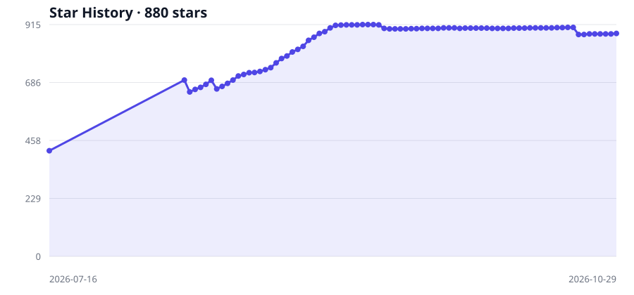

# FridayOS 1.0 — 本地优先的 AI 第二大脑与个人知识管理

[English](./README.md) · **简体中文** · [鲁滨逊实验室](./LAB.zh-CN.md)

<picture>
  <source media="(max-width: 600px)" srcset="./docs/images/six-brain-mobile.zh-CN.svg">
  
</picture>

**让知识像大脑一样分工，让 AI 沿着你的知识持续工作。**

FridayOS 1.0 是一个以 **六脑方法**为核心的开源个人知识管理（PKM）项目，提供本地 Markdown 蓝图、Obsidian 示例知识库和中英文教程，帮助你搭建自己的 AI 第二大脑。它参考人脑功能，把本地文件夹划分为相互协作的区域，连接资料、知识、任务和可复用方法。

**[六脑理论 →](./docs/SIX-BRAIN.zh-CN.md)**　 **[下载蓝图包 →](https://github.com/Robinson-AI-Lab/FridayOS1.0/raw/refs/heads/main/dist/FridayOS-Blueprint.zip)**　 **[开始部署 →](./docs/DEPLOYMENT.zh-CN.md)**

---

## 为什么是六脑

记下来的资料、正在推进的任务、已经形成的认识和反复使用的方法，需要不同的管理方式。Friday 从人脑的功能分工获得启发，为它们划定职责，再通过引用和反馈连接起来。

**六脑方法由滕新阳 Owen Teng 提出，在鲁滨逊实验室的 Friday 实践中发展。** 核心设计是把脑功能启发转化为目录职责、流转规则和人机协作方式。公开工具承担存储、界面与执行工作。

| 功能区 | 功能启发 | 你用它解决什么 |
|---|---|---|
| **捕获 · `inbox/`** | 新经验进入记忆；海马体相关功能类比 | 先接住想法和材料，再判断去向 |
| **执行 · `exec/`** | 前额叶相关的目标与执行控制 | 记住当前目标、进展和下一步 |
| **知识 · `wiki/`** | 皮层相关的知识与关联 | 把资料变成有来源、可复用的认识 |
| **技能 · `skills/`** | 程序性学习与习惯形成 | 将可靠经验整理成可重复的方法 |
| **证据 · `raw/`** | 外部原始记录机制 | 保存原件，检查结论从何而来 |
| **调节 · `system/`** | 基础运行调节的类比 | 让 AI 按明确规则和权限工作 |

“脑区”是设计类比。真实脑功能涉及协作网络，目录不与生物器官一一等同。**[查看完整理论、设计来源和边界](./docs/SIX-BRAIN.zh-CN.md)**。

## 从一次工作，到下一次能力

以“读三份资料，完成一份研究简报”为例：

1. **接住与查证**：接收资料，保留需要追溯的原件。
2. **理解与行动**：明确研究目标，关联已有知识，记录分歧和待确认项。
3. **交付与反馈**：形成简报，由人检查出处和结论。
4. **积累与复用**：修正知识，把经过反复验证的做法沉淀成技能。

六脑按用途流转，不要求每条信息走完全部区域。它希望帮助你找到依据、继续任务、复用方法；效果与成本通过自己的实际任务检验。

**Vibe Knowledge Management（VKM）** 是使用这套结构的交互方式：用自然语言提出目标、查询和修改，让 AI 在授权范围内整理与执行，人保留重要判断。

## 六脑核心，也能容纳更复杂的工作

| 扩展 | 在体系中的位置 |
|---|---|
| **副脑 · `domains/<project>/`** | 为一个项目或领域组织局部上下文；引用主脑，向主脑回流可复用知识 |
| **成果区 · `output/`** | 保存给人使用的当前成果；成果反馈进入下一轮学习 |
| **附件、工作空间与归档** | 支持材料、制作过程及历史保管，位置由使用者选择 |

六脑是核心分工，扩展不按文件夹数量继续增加“脑”。**完整蓝图包现已提供：默认部署六脑、副脑、成果区、附件，以及独立制作与归档空间；也可选择仅部署六脑核心。** [查看结构与部署说明](./docs/DEPLOYMENT.zh-CN.md)。

## 先看看它怎样工作

这里有一个现成的虚构沙盘：**示例大脑「云栈科技」**。示例包含公司、人物、项目和客户资料，配有 11 个提示词，供你练习检索、关联与方法复用。

**[下载示例大脑](./示例大脑-云栈科技.zip)** → 解压 → 在 Obsidian 中打开为独立 vault → 按演示手册配置插件并操作。示例内容为中文，使用虚构数据；它不代表真实客户成效，也不证明扩展能力已经接通。

## 开始你的 Friday

| 路径 | 下一步 |
|---|---|
| **先理解设计** | 阅读[六脑理论](./docs/SIX-BRAIN.zh-CN.md)，理解每个区为什么存在 |
| **自己搭建** | [下载部署包](https://github.com/Robinson-AI-Lab/FridayOS1.0/raw/refs/heads/main/dist/FridayOS-Blueprint.zip)，按[三步说明](./docs/DEPLOYMENT.zh-CN.md)预览、创建、检查 |
| **先体验内容** | 用[虚构示例](./示例大脑-云栈科技.zip)练习，再决定适合自己的结构 |
| **遇到问题** | 查看[常见问题](./常见问题.md)、[下载清单](./下载清单.md)，或[提交反馈](https://github.com/Robinson-AI-Lab/FridayOS1.0/issues) |

**部署只需 Python 3.9+，下载后可离线运行。** 完成目录部署后，再按[工具分工](./工具说明.md)选择工作环境。现有[工具安装示例](./安装指南.md)使用 **Obsidian + Claudian + Claude Code + 兼容模型服务**。Markdown 文件承载知识；连接配置工具按需选用。**飞书不是必需条件**，手动放入材料也能开始。模型、插件、费用和接口兼容性需按当前环境核对；其他工具组合不等于已经通过适配验收。

### 当前版本范围

- **仓库提供**：六脑理论、完整离线蓝图包、中英文说明、工具参考和虚构示例。
- **部署验收**：Windows 下验证首次部署、重复运行、冲突保护、核心版扩展及解压后独立运行；[查看验证范围](./docs/BLUEPRINT-VALIDATION.md)。
- **仍需分别验证**：macOS/Linux 实机、各 AI 工具的接入与新用户真实任务。自动维护、备份、原库迁移不由部署包执行。

FridayOS 1.0 聚焦个人知识工作。工作场景的 Agent OS 与更亲人的交互是持续探索方向，完整的任务协作和游戏式产品能力不属于本页已交付承诺。

## 一起发展这套方法

欢迎提交可复现的问题、使用反馈、教程或适配经验。反馈时请写明使用环境、操作步骤、预期与实际结果，并去掉私人资料和凭据。

[问题与讨论](https://github.com/Robinson-AI-Lab/FridayOS1.0/issues) · [MIT 许可](./LICENSE) · [滕新阳 Owen Teng](https://github.com/Robinson-AI-Lab/.github/blob/main/people/owen-teng.zh-CN.md)

由 **[Robinson AI Lab · 鲁滨逊](https://github.com/Robinson-AI-Lab)** 持续维护。原名 FridayOS-Lite；第三方工具保留各自的权属与许可。

项目关注记录

按实际采集记录展示，缺失日期不补造。关注量用于观察传播，不替代使用效果。

---

**FridayOS 1.0 · 六脑分工，一份蓝图，从自己的工作开始。**

