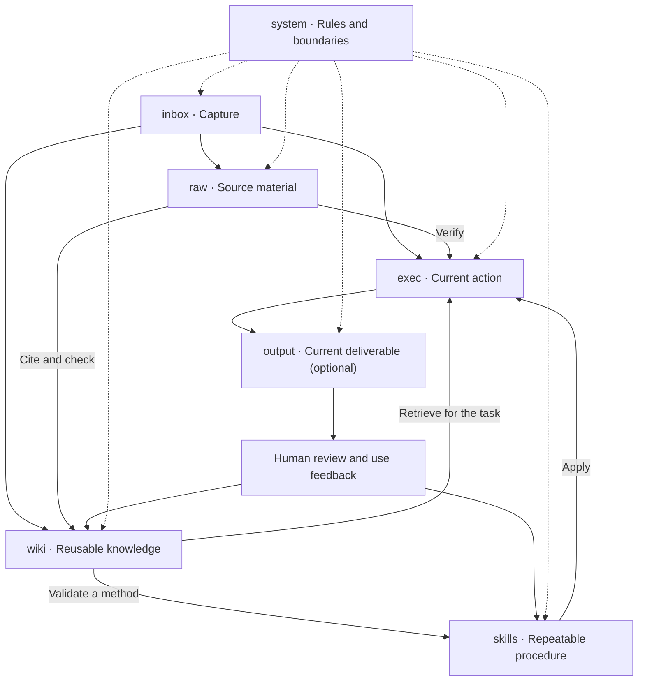

# The Six-Brain Method

**Proposed by Owen Teng · Robinson AI Lab**  
Theory note 1.0 · 2026-10-23  
[简体中文](./SIX-BRAIN.zh-CN.md) · [Project home](../README.md) · [Deployment blueprint](../FRIDAY-BLUEPRINT.md)

## Core idea

**Use the division of functions in the human brain as inspiration for organizing folders into cooperating regions, so information can be captured, understood, used in action, and developed into reusable capability.**

This is the starting point of Friday's Six-Brain Method. A folder expresses a responsibility: why content belongs there, when an AI should read it, who may update it, and how it supports the next step. The project's design contribution connects brain-inspired functional regions, information flow, human–AI responsibilities, and a deployable file blueprint.

Obsidian, Claudian, models, and other publicly available tools carry the method. Users choose suitable tools and entry points; Feishu and the author's personal environment are not prerequisites.

## 1. Why start with brain functions?

Working on a problem involves receiving information, maintaining a goal, connecting prior knowledge, applying learned procedures, and adjusting to feedback. A system that supports that work needs to address each responsibility.

A mixed collection makes it difficult to distinguish an original statement from a draft, an outdated conclusion, or a current task. Friday separates responsibilities and connects related content through references.

| Functional inspiration | Design choice |
|---|---|
| New input and established knowledge serve different purposes | Capture separately; receiving information does not mean accepting a conclusion |
| Current goals and long-term knowledge have different use patterns | Keep next actions in the execution region and reusable understanding in the knowledge region |
| Reliable procedures develop through learning | Record validated methods with conditions and checks |
| Functions must cooperate | Connect sources, tasks, knowledge, and feedback |
| Activity requires coordination | Keep rules and authority boundaries explicit |

**“Brain regions” are functional analogies.** Biological memory and executive function involve interacting networks. Six folders do not reproduce six anatomical organs or imply consciousness. Brain functions inspire the design; practical tasks must establish whether the method helps. The scientific background below does not validate Friday's effectiveness.

## 2. Six core regions

| Region | Functional inspiration or engineering addition | Folder | Responsibility |
|---|---|---|---|
| **Capture** | New experience entering memory; an analogy to the hippocampus's involvement in memory formation | `inbox/` | Receive unprocessed information and preserve its source before deciding its use |
| **Execution** | Goal maintenance and executive control associated with the prefrontal cortex | `exec/` | Maintain current goals, state, next actions, blockers, and decisions |
| **Knowledge** | Distributed knowledge and associations involving cortical networks | `wiki/` | Maintain sourced, revisable understanding that can be reused across tasks |
| **Skills** | Procedural learning and habit formation, with basal-ganglia-related functions as an analogy | `skills/` | Store repeatable methods, conditions, steps, and acceptance criteria |
| **Evidence** | An external original-record mechanism with no single anatomical equivalent | `raw/` | Preserve unchanged source material for tracing and checking interpretations |
| **Regulation** | An analogy to the brainstem's support for basic operation; permissions and written rules are engineering choices | `system/` | Coordinate behavior through rules, templates, and maintenance entry points |

A hippocampus is not an inbox, a prefrontal cortex is not a task list, and a brainstem does not store written policies. These analogies explain responsibilities; explicit rules determine actual behavior.

### Capture: receive before organizing

Recording an idea should not require an immediate decision about its project or retention period. Later, its purpose determines whether it becomes a task, evidence, or reusable knowledge. Age alone does not establish that material is worthless.

### Execution: maintain continuity

A task records why it matters, its current state, the next step, and decisions still needed. That record supports continuation in a later session. Weekly plans are optional templates, not a universal work style or a fixed biological limit on task count.

### Knowledge: maintain reusable understanding

A knowledge page records its subject, conclusions, sources, dates, and scope. New evidence can revise it. Links connect related pages, while each fact has a clear maintained home wherever possible.

### Skills: turn reliable experience into a method

A skill defines inputs, steps, outputs, limits, and checks. One good answer is a candidate method. Repeated applicability, explainability, testability, and correction support its promotion to a reusable skill. Saving a method document does not automatically install an Agent capability.

### Evidence: preserve the basis of interpretation

Knowledge changes; originals remain traceable. A source records what was said and may itself be wrong. Resolve disagreements by examining dates, provenance, and context rather than declaring that an original always wins.

### Regulation: stabilize cooperation

Rules define query entry points, destinations, source protection, updates, and authority. The AI reads what a task requires. Written rules do not enforce themselves; automation, external sending, and deletion still need tools, configuration, and user authorization.

## 3. How the regions cooperate

The six regions are not a mandatory sequence. Sources can directly support knowledge work, and a task may exist before evidence arrives. A common path is:

Two loops support each other:

- **Learning:** encounter information → check evidence → update understanding → test it in later work.
- **Execution:** define a task → retrieve knowledge and skills → deliver a result → use feedback to improve.

People set goals, decide important trade-offs, and judge whether results fit their needs. AI retrieves, connects, organizes, and executes within its authority. Human corrections become records that later work can use.

This accumulation happens in external files, rules, and retrieval. It does not train model weights or establish permanent model memory. **Vibe Knowledge Management (VKM)** names the natural-language way of interacting with this structure.

## 4. Project sub-brains and deliverables

The six regions define core responsibilities, not a requirement that every root contain exactly six folders.

### Sub-brains: scoped project or domain spaces

This edition uses “sub-brain” for a project or domain space such as `domains/<project>/`. It holds local goals, rules, source indexes, and specialized analysis. This extends the project-workbench interpretation; it is not an additional biological brain region.

A sub-brain references shared knowledge. Findings reusable across projects return to `wiki/`, and validated methods return to `skills/`; project-specific context stays scoped. Promotion does not change access permissions or authorize publication.

Supersession links or indexes identify the current maintained content. Ending a project does not authorize deleting its originals or useful records. A long-lived domain need not have an end date.

### output: the delivery boundary

`output/` holds current deliverables for people, such as reports, slides, or spreadsheets. The analogy is an effector acting on the world; an effector is not a seventh brain region.

Knowledge answers “what do we understand?” A deliverable answers “what are we providing for this purpose?” Its claims should trace to knowledge and evidence. Use feedback informs later learning. Keep current useful results; manage drafts and historical versions in the user's chosen workspace. Delivery does not imply immediate deletion.

### Supporting locations

`assets/` holds attachments; working directories hold drafts, code, or renders; optional archives hold less frequently used originals and history. These are storage and production roles, not more brains. Paths belong to the user's environment, without a required drive letter or cloud service.

## 5. Why tools can change

| Layer | Responsibility | Reference implementation and boundary |
|---|---|---|
| Method | Define responsibilities, flow, and reuse | Friday's Six-Brain rules and blueprint |
| Storage | Preserve, reference, and move content | Local Markdown and attachments; check links and configuration during migration |
| Interface | Let people inspect and edit content | Obsidian in current guides; alternatives need compatibility checks |
| AI execution | Load rules, retrieve files, and perform operations | Claudian with Claude Code in the guide; replacements need permission, rule-loading, and tool-call checks |
| Model and connection | Supply reasoning capability | Select for actual API compatibility, cost, and data needs; a switcher is optional |
| Input channels | Receive material | Manual files work; email, clipping, and Feishu are optional adapters |

Connections serve responsibilities rather than defining the knowledge structure. A manually supplied meeting file can use the core method without Feishu. Matching folder names alone does not establish integration or reliable rule enforcement.

## 6. A general example

For a research brief based on three documents:

1. Capture the material and state the research question.
2. Preserve necessary originals and record the deliverable goal and open questions in execution.
3. Develop sourced facts, disagreements, and understanding in knowledge.
4. Apply an established skill if available; otherwise record a candidate procedure.
5. Save the useful brief to `output/` when enabled, or to the user's chosen delivery location.
6. Review conclusions and citations. Feed corrections into knowledge; improve skills after repeated validation.

No HR dataset, Feishu account, or private author data is required. Complex research may use a sub-brain; a simple task can use the core regions directly.

## 7. Design provenance and evaluation

**Owen Teng proposed Friday's Six-Brain Method, developed through Friday practice with Robinson AI Lab.** The contribution described here is the combination of a brain-functional metaphor, six responsibilities, information flow, human–AI cooperation, and a deployable file blueprint.

Inboxes, linked notes, project management, knowledge lifecycles, and reusable procedures have prior traditions. Friday builds on those foundations through its specific arrangement and rules. This account does not claim to invent neuroscience, Markdown, AI Agents, third-party tools, or establish global priority.

Evaluate the method with the same material and tasks: can people find sources, distinguish current content from superseded content, resume unfinished work, reuse validated methods, and correct errors? Compare reading scope, time, and model cost using actual records; region separation alone does not establish a fixed saving.

Scientific background:
- [NINDS: Know Your Brain](https://www.ninds.nih.gov/sites/default/files/2025-05/know-your-brain-brian-basics.pdf).
- [NIMH: Get to Know Your Brain](https://www.nimh.nih.gov/news/media/2023/get-to-know-your-brain).
- [Foerde and Shohamy: The role of the basal ganglia in learning and memory](https://pmc.ncbi.nlm.nih.gov/articles/PMC3772079/).

## 8. What this edition delivers

This update explains the theory, revises the bilingual homepages and tool roles, and adds the rationale inside the blueprints. The current blueprint provisions six core regions. Sub-brains, `output/`, and external archives are described as extensions, not a shipped all-extension installer. Installation, automated organization, and cross-tool compatibility need environment-specific verification.

Start with the [deployment blueprint](../FRIDAY-BLUEPRINT.md), then validate your own Six-Brain workspace with one real task.

