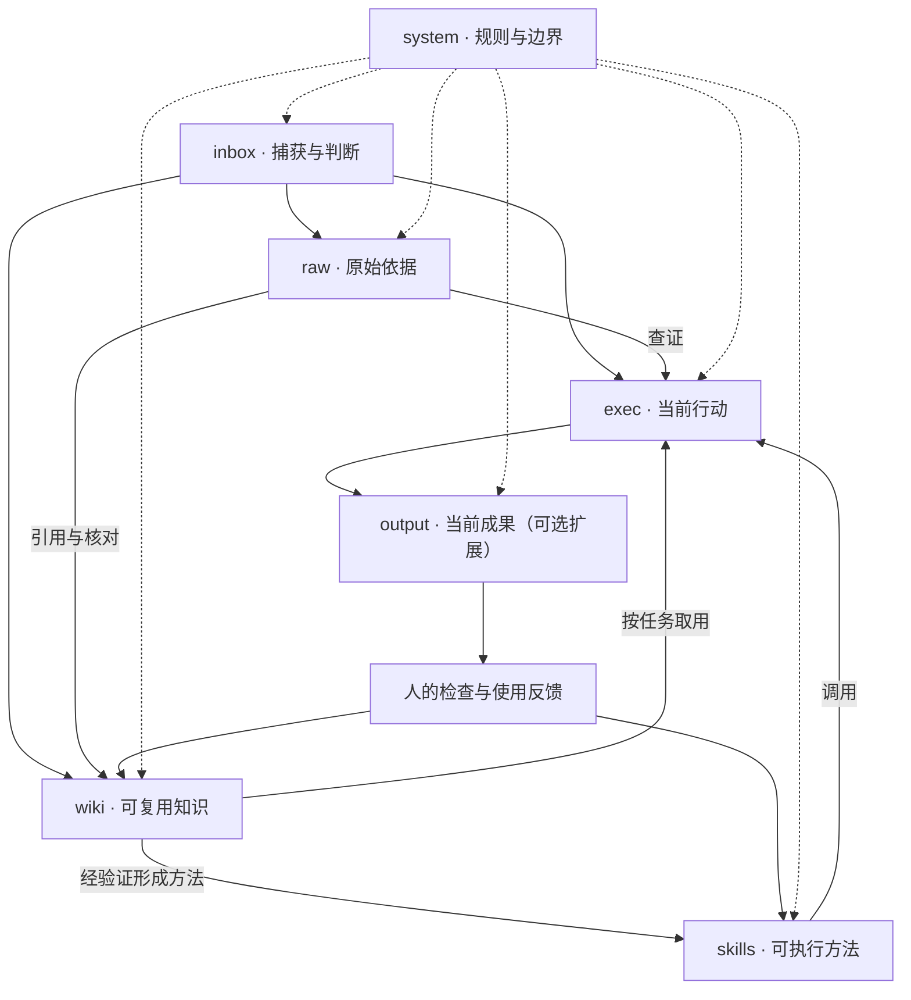

# 六脑理论：参考人脑功能组织知识与行动

**提出者：滕新阳 Owen Teng · 鲁滨逊 Robinson AI Lab**  
理论说明版本：1.0 · 2026-10-23  
[English](./SIX-BRAIN.md) · [项目首页](../README.zh-CN.md) · [部署蓝图](../Friday大脑蓝图.md)

## 核心主张

**参考人脑不同功能的分工，把文件夹设计成相互协作的功能区，让信息能够被接住、被理解、支持行动，并逐渐沉淀成可复用的能力。**

这是 Friday 六脑方法的设计起点。文件夹名称表达的是工作职责：某份内容为什么留在这里、AI 何时应该读它、谁可以更新它、怎样进入下一步。六脑的原创设计重点是将脑功能启发转化为一套可部署的知识工作结构，并将分区、流转规则和人机分工连接起来。

Obsidian、Claudian、模型和其他公开工具承载这套方法。使用者可以选择适合自己的入口和工具；理论不依赖飞书，也不要求复制提出者的个人环境。

## 1. 为什么从人脑功能出发

人处理事情时，需要接收新信息、保持当前目标、联系已有认识、调用熟练做法，并依据反馈调整行动。设计一个帮助人工作的知识系统，也需要分别回答这些问题。

如果所有内容混放，检索到的可能是原始说法、未完成草稿、已经过时的结论或当前任务，却看不出它们各自的身份。六脑先划清职责，再通过引用把内容连接起来。

| 人脑功能带来的启发 | Friday 的设计选择 |
|---|---|
| 新输入与长期记忆承担不同作用 | 捕获区与知识区分开；收到信息不自动等于接受结论 |
| 当前目标与长期知识有不同使用节奏 | 执行区保存下一步，知识区保存可跨任务复用的认识 |
| 熟练做法可以通过学习形成 | 将经过验证的方法整理为技能，记录适用条件与检查标准 |
| 各功能需要协作 | 用来源链接、任务引用和反馈建立流转关系 |
| 活动需要约束和调节 | 将工作约定集中到规则区，明确操作范围和人的决定权 |

**“脑区”在这里是功能类比。** 人脑的记忆和执行涉及相互作用的网络，六个文件夹并不是六个真实脑器官的复刻，也不意味着系统具有意识。脑功能提供设计灵感，方法是否有用仍要通过具体任务检验。神经科学背景入口见文末；它们不构成对 Friday 效果的验证。

## 2. 六个核心功能区

| 功能区 | 人脑功能启发或工程补充 | 目录 | 核心职责 |
|---|---|---|---|
| **捕获脑区** | 新经验进入记忆的过程；借海马体参与记忆形成作类比 | `inbox/` | 接住未处理的信息，保留来源，等待判断用途 |
| **执行脑区** | 前额叶相关的目标维持与执行控制 | `exec/` | 记录当前目标、状态、下一步、阻塞和决策 |
| **知识脑区** | 皮层相关的分布式知识与关联 | `wiki/` | 维护有来源、可修正、可跨任务复用的认识 |
| **技能脑区** | 程序性学习与习惯形成；借基底节相关功能作类比 | `skills/` | 保存可重复的方法、步骤、适用条件和验收标准 |
| **证据脑区** | 为外部记忆补充的原始记录机制，无单一脑器官对应 | `raw/` | 保存不可改写的原件，让解释和结论能够追溯 |
| **调节脑区** | 借脑干维持基础运行作类比；权限与规则是工程设计 | `system/` | 保存行为约定、模板和维护入口，协调各区工作 |

海马体不是文件收件箱，前额叶不是待办清单，脑干也不保存文字规则。这些名称帮助理解职责；每个目录的实际行为由明确的工作规则决定。

### 捕获脑区：先接住，再判断

记下一段想法时，不必同时决定它属于哪个项目、值得保留多久。捕获区降低记录时的负担。后续根据用途决定形成任务、保存证据、提炼知识，或按使用者的保留规则处理。不能因为停留时间长，就推定信息没有价值。

### 执行脑区：保持行动连续性

任务页回答“为什么做、做到哪里、下一步是什么、需要谁决定”。新会话可以沿着记录继续推进。周计划只是可选模板；不同使用者可以按项目、期限或对话组织工作，不要求统一的日程习惯或固定任务数量。

### 知识脑区：维护可以再用的认识

知识页说明对象、结论、依据、时间及适用范围。它可以随着新证据修正。相关页面通过链接连接，而同一事实尽量保留一个明确维护位置，避免多份内容互相竞争。

### 技能脑区：把可靠经验变成可执行方法

技能需要说明输入、步骤、输出、适用边界和检查方式。一次成功回答可以成为方法候选；反复适用、能够解释、能够检查并能纠错之后，才适合交给 AI 重复执行。保存一个技能文档，并不自动完成某个 Agent 的技能安装。

### 证据脑区：保留解释所依赖的原件

知识会更新，原件保持可追溯。证据区记录“来源曾经说了什么”；来源本身也可能错误。资料之间有冲突时，检查日期、出处和上下文，保留未决问题，而不是规定任何原件都自动获胜。

### 调节脑区：使分工稳定

规则区明确查询入口、文件去向、原件保护、更新方式与授权范围。AI 按任务读取需要的规则和内容。写下规则不等于已经有程序强制执行；自动化、外发和删除能力还需要相应工具、配置及使用者授权。

## 3. 六脑怎样协作

六个区不是必须依次经过的流水线。资料可直接支持知识整理；任务可以先存在，再补充证据。以下展示一条常见路径：

这形成两个相互支持的循环：

- **学习循环**：接触信息 → 核对证据 → 更新认识 → 在下一次工作中检验。
- **执行循环**：明确任务 → 调取知识与技能 → 形成成果 → 接收反馈并改进。

人的职责包括提出目标、判断重要取舍、确认成果是否适用；AI 在授权范围内承担检索、关联、整理和执行。人的修正也进入记录，使后续工作可以利用它。

这种积累发生在外部文件、规则与检索中，不意味着模型参数被训练或 AI 已获得永久记忆。我们用 **Vibe Knowledge Management（VKM）** 描述通过自然语言使用这套结构的交互方式。

## 4. 副脑与成果区怎样扩展

六脑是核心职责模型，不要求所有人的根目录恰好只有六项。

### 副脑：有范围的项目或领域空间

本版采用“副脑”作为 `domains/<project>/` 一类项目或领域空间的称呼。它保存该范围的目标、局部规则、材料索引与专项分析；这是对项目工作台的扩展解释，不是新增的生物脑区。

副脑通过引用使用主脑知识。新发现中可跨项目复用的内容回流至 `wiki/`，成熟方法回流至 `skills/`；项目特有信息留在原范围。提升到主脑不改变资料的访问权限，也不等于对外公开。

旧页面用替代关系或索引指向当前内容。项目结束不自动授权整包删除，原件和仍有用途的记录继续按保留规则管理。长期领域副脑也不必具有固定结束日期。

### output：成果出口

`output/` 保存给人直接使用的当前成果，如报告、演示文稿、表格。它借用“效应器把行动作用于外部世界”的比喻；效应器不是第七个脑区。

知识页回答“我们知道什么”，成品回答“这次交付什么”。成品的结论可追溯到知识和证据；使用反馈再帮助修正知识与方法。保留当前有效成果，制作过程和历史版本按使用者的工作空间方案管理，不把“已交付”理解为立即删除。

### 其他支持目录

`assets/` 承载附件；工作目录承载草稿、代码或渲染；可选归档位置承载低频原件与历史。这些是存储和工作职责，不按目录数量继续增加“脑”的数量。所有路径由使用者选择，不绑定某个盘符、冷盘或云服务。

## 5. 为什么工具可以换

| 层次 | 解决的问题 | 当前参考实现与选择边界 |
|---|---|---|
| 方法 | 内容属于什么职责，何时流转、如何复用 | 六脑规则与蓝图，由 Friday 项目维护 |
| 存储 | 内容怎样长期保存、引用和迁移 | 本地 Markdown 与附件；迁移还要核对链接和工具配置 |
| 界面 | 人怎样查看和编辑内容 | Obsidian 是当前文档示例，其他界面需验证兼容性 |
| AI 执行 | 谁读取规则、检索文件并执行操作 | 当前指南使用 Claudian 与 Claude Code；替换需检查文件权限、规则加载及工具调用 |
| 模型与连接 | 怎样提供推理能力 | 根据实际接口兼容性、成本和数据要求选择；切换器按需使用 |
| 输入渠道 | 内容从哪里来 | 手动文件已经可用；邮件、剪藏、飞书等是可选适配 |

工具之间的连接应服务于职责，而不决定知识结构。飞书未配置时，手动放入会议文件仍然可以使用核心方法。文件夹名称相同，也不代表工具已经接通或规则已经被可靠执行。

## 6. 一个通用例子

以“根据三份资料写一份研究简报”为例：

1. 把资料放入捕获区，并说明研究问题。
2. 保存需要追溯的原件；在执行区记录交付目标和未解决问题。
3. 在知识区整理有来源的事实、分歧和认识，按需建立关联。
4. 有可靠方法时调用技能；没有时记录本次做法，暂不称为成熟技能。
5. 启用成果区时，将可用简报放入 `output/`；否则采用用户指定交付位置。
6. 人检查结论和出处，反馈进入知识页；反复验证后改进或形成技能。

这个例子不需要 HR 数据、飞书账号或提出者的私人资料。复杂研究可以增加副脑；简单任务直接使用核心区。

## 7. 设计来源与实践检验

**Friday 六脑方法由滕新阳 Owen Teng 提出，在鲁滨逊实验室的 Friday 实践中发展。** 本项目主张的设计贡献是：以脑功能分工作为组织隐喻，将六种职责、信息流转、人机协作及可部署文件蓝图整合成知识工作方法。

收件箱、卡片链接、项目管理、知识生命周期和技能复用各有既有思想与实践。Friday 借鉴这些基础，贡献体现在具体组合、规则和实践表达；本说明不主张发明脑科学、Markdown、AI Agent 或其他第三方工具，也不主张已经证明全球首次。

六脑的效果可以用相同资料和任务检验：能否找到可靠出处、区分当前与过时内容、继续未完成任务、复用经过验证的方法，以及通过反馈修正错误。读取范围、耗时和模型费用按实际记录比较，不能仅凭分区推导固定降本比例。

神经科学背景：
- [NINDS：Know Your Brain](https://www.ninds.nih.gov/sites/default/files/2025-05/know-your-brain-brian-basics.pdf)：脑结构与功能的入门说明。
- [NIMH：Get to Know Your Brain](https://www.nimh.nih.gov/news/media/2023/get-to-know-your-brain)：额叶、脑干等功能介绍。
- [Foerde 与 Shohamy：The role of the basal ganglia in learning and memory](https://pmc.ncbi.nlm.nih.gov/articles/PMC3772079/)：讨论程序性学习、记忆系统的分工与相互作用。

## 8. 本版交付边界

完整离线蓝图包已将六脑、副脑、`output/`、附件和独立制作/归档空间部署为目录、规则与空白模板；也可选择核心版。参见[部署说明](DEPLOYMENT.zh-CN.md)。目录生成支持这些方法的使用，不会自动执行资料路由、成果发布、清理或备份。AI 规则加载、模型连接、跨工具适配和真实任务效果仍须在所选环境中分别验收。

从[部署蓝图](../Friday大脑蓝图.md)开始，以一次实际操作验证你自己的六脑。

